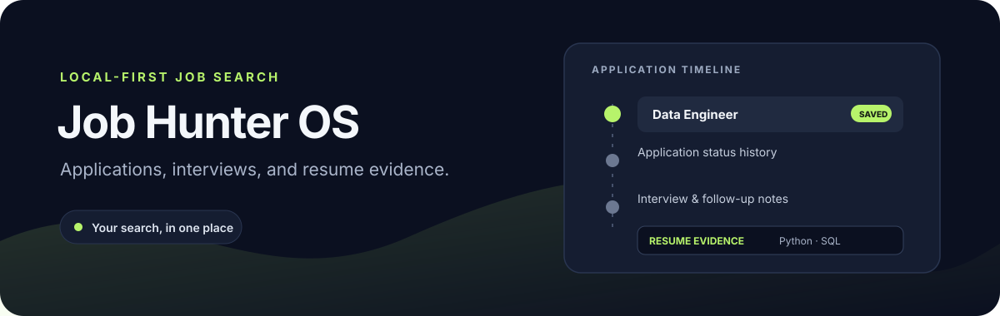

# Job Hunter OS



**A local-first tracker for applications, interviews, and follow-ups.** Keep a clear history of each application in SQLite, compare a vacancy with resume evidence, and optionally search public HH.ru vacancies.

[](https://github.com/jezannn16/job-hunter-os/actions/workflows/ci.yml)

[Features](#what-it-does) · [Quick start](#quick-start) · [HHru search](#search-hhru) · [Tests](#tests-and-ci) · [Data and scope](#data-and-scope)

## What it does

| Area | Available now |
| --- | --- |
| Applications | Add manually or import vacancy text; repeated URL or no-URL company/title entries reuse the existing record; filter and export CSV or Markdown |
| History | Track constrained status changes, notes, interview dates, and follow-up tasks |
| Reminders | List due follow-ups; optional timezone-aware background Telegram scheduler with quiet hours and durable once-per-local-day deduplication |
| Resume evidence | Compare a vacancy with a local resume file and show matching snippets |
| Vacancy search | Read-only public HH.ru search; saving results is an explicit option |
| Storage | Local SQLite database; no account or API key required |

The resume score is a small vocabulary-overlap heuristic, not a suitability judgment or offer probability. Skills absent from the resume are reported as unmentioned, not as proof of lacking them.

## Quick start

Requires Python 3.11 or newer.

```sh
python3 -m venv .venv
. .venv/bin/activate
python -m pip install -e '.[dev]'
```

Try a complete local workflow with a throwaway database:

```sh
python job_hunter.py --db /tmp/jobs-demo.sqlite3 add 'Data Engineer' 'Example Co' \
  --url https://example.org/job --description 'Required: Python, SQL. Preferred: Docker.'
python job_hunter.py --db /tmp/jobs-demo.sqlite3 status 1 applied
python job_hunter.py --db /tmp/jobs-demo.sqlite3 dashboard
printf 'Python and SQL experience in ETL projects.\n' > /tmp/resume-demo.txt
python job_hunter.py --db /tmp/jobs-demo.sqlite3 match 1 /tmp/resume-demo.txt
python job_hunter.py --db /tmp/jobs-demo.sqlite3 export-md
python job_hunter.py --db /tmp/jobs-demo.sqlite3 reminders
python job_hunter.py --db /tmp/jobs-demo.sqlite3 interview-question-add 1 'How do you handle retries?'
python job_hunter.py --db /tmp/jobs-demo.sqlite3 interview-questions
```

The match output includes evidence snippets for Python and SQL and lists Docker as unmentioned. Match either a local resume file or a saved version with `python job_hunter.py --db /tmp/jobs-demo.sqlite3 match 1 --resume-version 1`; saved versions can be listed with `resume-list`. Data remains in the local database; resume files are read locally.

## Search HH.ru

Public vacancy search is a read-only anonymous request and needs no credentials. Search without saving results:

```sh
python job_hunter.py --db /tmp/jobs-demo.sqlite3 hh-search 'аналитик данных' --page 0
```

Add `--save` only when you want the returned vacancies stored in the selected database. The search uses one page per request, an identifying User-Agent, bounded retries for 429/5xx and transient network errors, and honors `Retry-After` up to 30 seconds. Successful search pages are cached for five minutes in the selected local database. Results expose HH publication time and local fetch time; repeated URL saves reuse the existing vacancy. See the [HH.ru vacancy API](https://github.com/hhru/api/blob/master/docs/vacancies.md).

## Tests and CI

```sh
pytest -q
ruff check .
```

The default suite uses a temporary SQLite database and mocks HH.ru and Telegram transports. It covers the reminder scheduler with fake clocks, fake delivery APIs, quiet hours, and persistent deduplication. An optional live smoke test checks the public search endpoint; it is read-only and skipped unless explicitly enabled:

```sh
RUN_LIVE_TESTS=1 pytest -q -m live
```

Network availability and HH.ru policy can affect that optional check. It does not save results.

## Data and scope

Vacancy descriptions and saved resume versions are stored as plain text in SQLite. On POSIX systems the database and SQLite backup are restricted to the current user (mode 0600). The database is still unencrypted; use a private directory and avoid sensitive information on shared or unencrypted storage.

There is no auto-apply, website scraping, or external calendar integration. Interview events accept ISO datetimes with offsets and list chronologically across timezones. Add and review preparation questions with `interview-question-add EVENT_ID QUESTION` and `interview-questions`; save post-interview notes with `interview-note-add EVENT_ID TEXT` and review them with `interview-notes`. `reminders` only prints due follow-ups; `reminders --record` records a single reminder per task and its due-time local date. The optional background scheduler sends Telegram messages only after an explicit `--enable-notifications` plus token and destination environment-variable names, an IANA timezone, and quiet-hour boundaries are supplied:

```sh
# Load these from a private shell environment or secret manager; do not put values in shell history.
python job_hunter.py --db ~/.local/share/job-hunter.sqlite3 reminder-scheduler \
  --enable-notifications \
  --telegram-token-env JOB_HUNTER_TELEGRAM_BOT_TOKEN \
  --telegram-chat-id-env JOB_HUNTER_TELEGRAM_CHAT_ID \
  --timezone Europe/Moscow --quiet-start 22:00 --quiet-end 08:00 --poll-seconds 60
```

Without the enable flag, the scheduler exits without opening the database or making network requests. Each task is claimed before sending under a unique `(task, local day)` key; successful sends are recorded, and uncertain outcomes are marked `unknown` and never retried that day. A crash after claiming but before sending can suppress that day's reminder, favoring no duplicate over guaranteed delivery. `--once` performs one scan for a controlled smoke test; it still requires explicit enablement and real settings, so use fake API tests for development. `followup-complete ID` closes a task. CSV export prefixes spreadsheet formula-like text with an apostrophe to prevent formula execution when opened in spreadsheet software. Matching supports a deliberately small Russian/English skill vocabulary.

See [demo steps](docs/demo.md) for the synthetic walkthrough.
